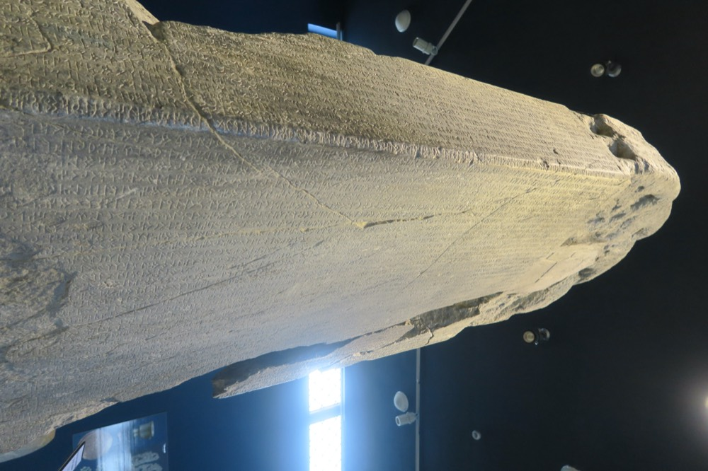

# tengri 𐱅𐰭𐰼𐰃

Old Turkic (Göktürk, Orkhon) script in your terminal.

```sh
npx tengri
```

A random line from the Orkhon inscriptions or Kutadgu Bilig in a small frame: Old Turkic script, Latin transcription, modern Turkish and English.

```
╭─ 𐱅𐰭𐰼𐰃 ─────────────────────────────────────────────────────────────────╮
│                                                                        │
│  𐰇𐰔𐰀⁚𐰚𐰇𐰚⁚𐱅𐰭𐰼𐰃⁚𐰽𐰺𐰀⁚𐰖𐰍𐰃𐰔⁚𐰘𐰼⁚𐰴𐰃𐰞𐰣𐱃𐰴𐰑𐰀⁚𐰚𐰃𐰤⁚𐰺𐰀⁚𐰚𐰃𐱁𐰃⁚𐰆𐰍𐰞𐰃⁚𐰴𐰃𐰞𐰣𐰢𐱁             │
│  üze kök tengri asra yağız yer kılıntukda ekin ara kişi oğlı kılınmış  │
│                                                                        │
│  Üstte mavi gök, altta yağız yer var edilirken, ikisinin arasına       │
│  insanoğlu da var edilmiş.                                             │
│  When the blue sky above and the dark earth below were made, between   │
│  the two the children of men were made as well.                        │
│                                                                        │
│  — Kül Tigin inscription, KT E 1 = BK E 2–3                            │
│                                                                        │
╰───────────────────────────────────── made by Kerem Noras (noras.tech) ─╯
```

Write your own:

```sh
npx tengri "kök türk"      # 𐰚𐰇𐰚⁚𐱅𐰇𐰼𐰚
```

Your terminal needs a font with the Old Turkic block (U+10C00–10C4F), for example Noto Sans Old Turkic. Without one you see empty boxes; the Latin line under each quote still reads fine.

## Library

```js
import { transliterate, randomQuote, quotes } from 'tengri'

transliterate('tengri') // 𐱅𐰭𐰼𐰃
randomQuote()           // { source, ref, script, text, tr, en }
```

Zero dependencies, Node 18+.

## The first word



*The Kül Tigin stele (732), Orkhon Valley, Mongolia. Photo: [Vezirtonyukuk](https://commons.wikimedia.org/wiki/File:Kultigin_Monument_of_Orkhon_Inscriptions.jpeg), CC BY-SA 4.0, resized.*

In 1889 Nikolai Yadrintsev's expedition found two huge stone steles in Mongolia's Orkhon Valley, set up in the early 8th century for the brothers Kül Tigin and Bilge Kagan. They were covered in an unknown alphabet, and in places in Chinese. Nobody could read the script.

Vilhelm Thomsen, a Danish linguist in Copenhagen, worked from rubbings and photographs. On 15 December 1893 he announced to the Royal Danish Academy that the script was an alphabet and the language was Turkic. (Some sources give 25 November.) That date is now World Turkic Language Family Day.

The retelling in Turkish sources goes like this: he looked for the words that kept recurring and found the first one, *tengri* (𐱅𐰭𐰼𐰃, "sky, god"), then *Türk*, and the rest followed. I could not confirm this in an academic source, so take the order of events as tradition. Wilhelm Radloff, who had already published the texts, read them in full soon after with Thomsen's key. Thomsen's own account came out in 1896 (*Inscriptions de l'Orkhon déchiffrées*).

That is why this package is called `tengri`.

## How the transliteration works

`transliterate` is a heuristic over Turkish spelling or scholarly Old Turkic transcription (ä ï ŋ š γ q work too). It follows the main conventions of the Orkhon stones:

- consonants `b d g k l n r s t y` have a back-vowel and a front-vowel letter; the nearest vowel picks one
- `a`/`e` are written only at the end of a word; of `ı i o u ö ü` only the first and a final one are written
- words are separated by `⁚` (U+205A), as on the stones
- syllable signs and ligatures (𐰸 𐰜 𐰦 𐰡 …) are never emitted

It spells *tengri*, *bodun*, *asra* as the stones do. It will not match every carved spelling, since the stones themselves vary. Treat the output as a reading aid, not an edition.

## Quotes and sources

`data/quotes.json` holds 15 short passages: 10 from the Kül Tigin inscription (with the Bilge Kagan parallels) and 5 couplets of the *Kutadgu Bilig* (Yusuf Has Hacib, 1069).

- The 8th–11th century texts are public domain. The transcriptions are simplified Latin spellings, cross-checked against the Turkish Wikisource editions of the inscriptions and published studies (Ayaz 2021, Bilgin 2005, Mert & Albayrak 2013). Where editions disagree, the quote's `note` says so.
- The Turkish and English renderings are my own, not taken from any published translation. They are not scholarly translations. Corrections are welcome.
- Line labels: E, S, N = east, south, north face. `Tengri teg Tengride…` is KT S 1 / BK N 1.
- *Kutadgu Bilig* is written in Karakhanid Turkic with Arabic letters, never in Göktürk script. The Old Turkic letters shown for it are a **stylization**: the same rules as above applied to the Latin text, nothing a scribe ever wrote. The frame says so (`stylized script` in the top border, `script: "stylized"` in the data). Couplet numbers follow the common Arat-based numbering; the Fergana manuscript numbers differ (211 is 208 there).

## License

MIT for the code. The stele photo is CC BY-SA 4.0 (see caption).
